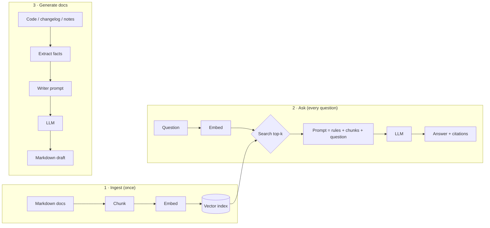

# 📘 Product Docs AI

A beginner-friendly **Generative AI toolkit for product documentation**, built from scratch in readable Python so you can see how every piece works.

It does two jobs:

| Feature | What it does | GenAI technique |
|---|---|---|
| 💬 **Docs Q&A assistant** | Answers questions about your product using *only* your docs, with citations | RAG (Retrieval-Augmented Generation) |
| ✍️ **Docs generator** | Writes API reference pages, release notes and how-to guides | Fact extraction + prompt engineering |

It works with **Claude (Anthropic)**, **OpenAI GPT**, **free local models via Ollama**, or an **offline mock model** (no API key, no cost), switched with one line in a `.env` file.

> New to GenAI? Start with **[LEARNING_GUIDE.md](LEARNING_GUIDE.md)**: 9 short lessons that walk through the code in this repo.

---

## How it works



## Quick start (5 minutes, free)

You need **Python 3.10+** and **Git**.

```bash
# 1. Get the code
git clone https://github.com/<your-username>/product-docs-ai.git
cd product-docs-ai

# 2. Create a virtual environment (an isolated box for this project's packages)
python -m venv .venv
# Windows:
.venv\Scripts\activate
# macOS / Linux:
source .venv/bin/activate

# 3. Install
pip install -r requirements.txt
pip install -e .            # makes the `docai` command available

# 4. Settings: copy the example (it uses the free mock model by default)
cp .env.example .env        # Windows: copy .env.example .env

# 5. Try it
docai ingest sample_product/docs
docai ask "How do I reset my password?"
docai gen-release sample_product/CHANGELOG.md --version 2.4.0
streamlit run app.py        # web UI at http://localhost:8501
```

## Use a real LLM

Edit `.env`:

| Provider | Set in `.env` | Notes |
|---|---|---|
| Claude | `LLM_PROVIDER=anthropic` and `ANTHROPIC_API_KEY=...` | Key from console.anthropic.com |
| OpenAI | `LLM_PROVIDER=openai` and `OPENAI_API_KEY=...` | Key from platform.openai.com. You can also set `EMBEDDING_PROVIDER=openai` |
| Ollama (free, local) | `LLM_PROVIDER=ollama` | Install ollama.com, then `ollama pull llama3.2` |

For better search, use semantic embeddings: `EMBEDDING_PROVIDER=openai` or `ollama` (`ollama pull nomic-embed-text`). **Re-run `docai ingest` after changing the embedding provider.**

Model names change over time; if you get a "model not found" error, check your provider's current model list and update `ANTHROPIC_MODEL` / `OPENAI_MODEL` / `OLLAMA_MODEL`.

## Commands

| Command | Purpose |
|---|---|
| `docai ingest <folder>` | Index all `.md`/`.txt` files in a folder |
| `docai ask "<question>"` | One question, answer with sources |
| `docai chat` | Interactive Q&A |
| `docai gen-api <file.py>` | API reference → `output/api_reference.md` |
| `docai gen-release <changelog> --version X` | Customer-facing release notes |
| `docai gen-howto "<title>" <notes.txt>` | Step-by-step guide from rough notes |
| `python evaluate.py` | Measure retrieval quality (hit rate) |
| `pytest` | Run the tests (offline, free) |

(If you skipped `pip install -e .`, use `python -m docai ...` with `PYTHONPATH=src`.)

## Project structure

```
product-docs-ai/
├── src/docai/
│   ├── config.py        # settings from .env
│   ├── llm.py           # one interface → Claude / OpenAI / Ollama / Mock
│   ├── embeddings.py    # text → vectors (hashing / OpenAI / Ollama)
│   ├── chunking.py      # split docs into searchable pieces
│   ├── vector_store.py  # tiny NumPy vector database (cosine similarity)
│   ├── prompts.py       # every prompt in one place
│   ├── rag.py           # Q&A assistant: ingest → retrieve → generate
│   ├── generator.py     # docs generator: extract facts → write
│   └── __main__.py      # command-line interface
├── sample_product/      # docs, code and changelog of "TaskFlow", a fictional app
├── tests/               # pytest suite (uses the mock model)
├── app.py               # Streamlit web UI
├── evaluate.py          # retrieval evaluation
├── LEARNING_GUIDE.md    # the course
└── .github/workflows/   # CI: runs tests on every push
```

## Use it on your own product

1. Put your Markdown/text docs in a folder, e.g. `my_docs/`.
2. `docai ingest my_docs`
3. Add 10-20 of your own question → file pairs to `evaluate.py` and check the hit rate.

## Limitations (by design, to keep it simple)

- The vector store is in-memory NumPy: great up to tens of thousands of chunks. Use Chroma/FAISS/pgvector beyond that.
- Only `.md`/`.txt` input. PDF/HTML loaders are a good exercise (see the guide).
- AI-written docs are **drafts**: always have a human review them.

## License

MIT. The TaskFlow product, its docs and its code are fictional sample data.
